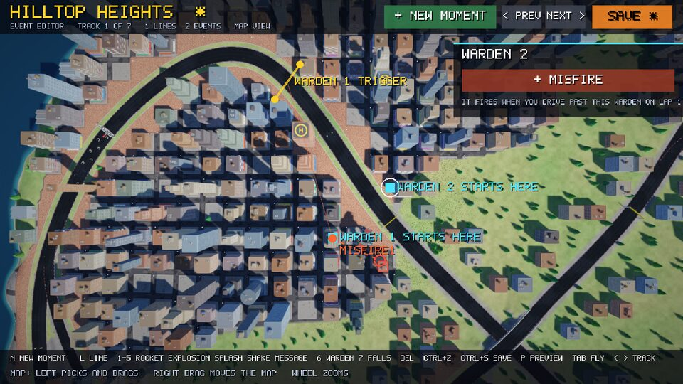
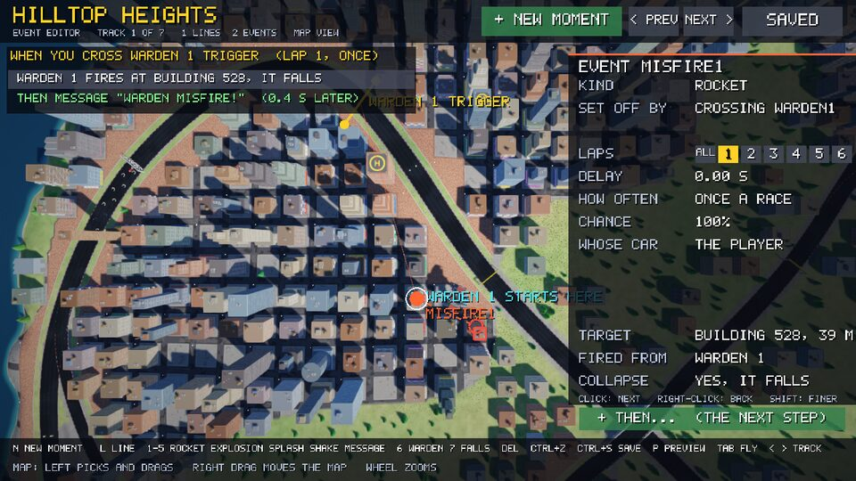
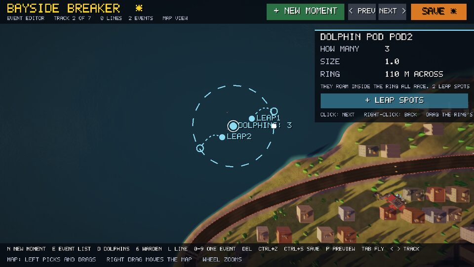
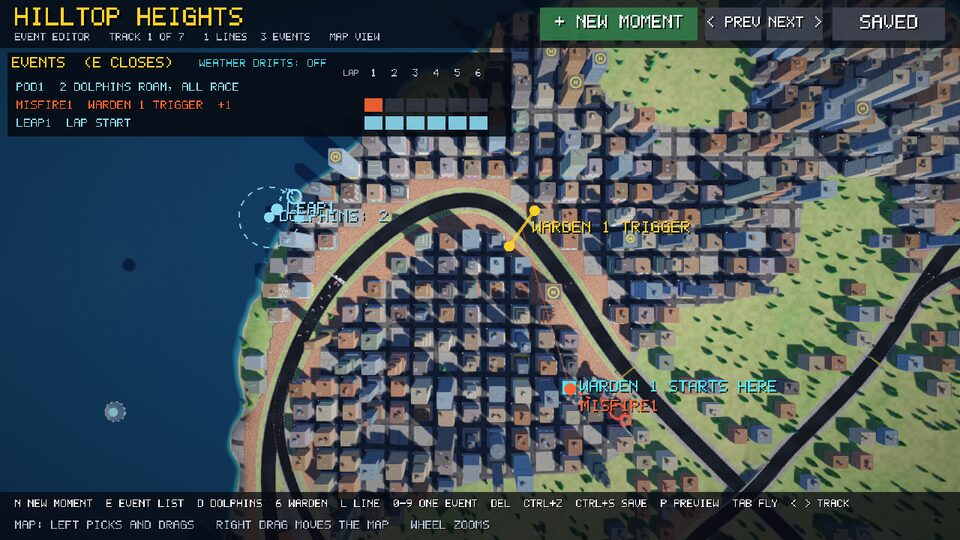
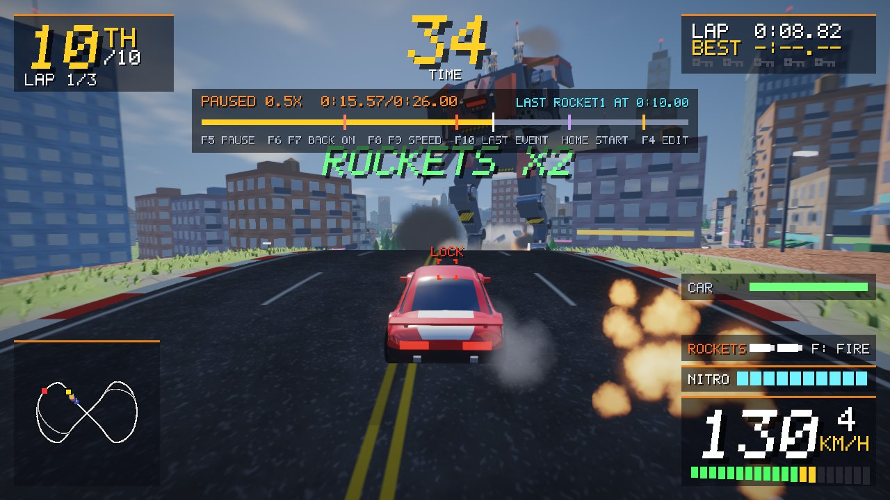

# fcfedit — the event editor

fcfedit scripts what happens during a race on any track: a Warden's rocket misfires and brings a tower down, a message
flashes up, the camera shakes, an explosion goes off as you pass. You make each **moment** with a few clicks, preview it
in a real race, and save it. The game plays it from then on.

(The *track* editor, for roads, hills and tunnels, is a different tool: see [EDITOR.md](EDITOR.md). The event file format
and the race director behind it are in [EVENTS.md](EVENTS.md).)

## Starting it

    make fcfedit && ./fcfedit --track 0      # Linux (x64 and arm64 builds are on the releases page)
    fcfedit.exe --track 0                    # Windows (make windows)
    ./fogcityfury --evedit --track 0         # the same editor inside the game

It opens Hilltop Heights (track 0) unless you name another one. Use **< PREV / NEXT >** at the top, or the `<` `>` keys,
to change track. Your changes are saved first.

## A Warden misfire, start to finish

1. **Place a Warden.** Press `6` and click beside the road. This is where the Warden starts walking (up to four
   Wardens per track).
2. **Click the Warden**, then click **+ MISFIRE** in the panel on the right.
   The editor does the rest:
   - It draws the Warden's own trigger line across the road, about 70 m before the Warden.
   - It aims a rocket a little way past the Warden.
   - It adds a "WARDEN MISFIRE!" message straight after the rocket.
3. **Drag the red ring onto a building.** The building is outlined in red and **COLLAPSE** changes to **YES, IT FALLS**.
   The rocket hitting the building brings it down, so you don't place a separate collapse. Leave the ring on open
   ground and the rocket just explodes there.
4. **Press `P`** to preview the race. Cross the line on lap 1 and watch the tower fall. `F4` comes back to the editor. Missed it? `F10` takes
   you back to 3 seconds before it; `F8` slows it down (see [The preview's tape](#the-previews-tape)).
5. **`CTRL+S`** (or the **SAVE** button) saves it.

When an event is selected, the **chain box** (top left) shows the whole moment in plain words:

    WHEN YOU CROSS WARDEN 1 TRIGGER  (LAP 1, ONCE)
      WARDEN 1 FIRES AT BUILDING 528, IT FALLS
      THEN MESSAGE "WARDEN MISFIRE!"  (0.4 S LATER)

Click a line in the chain box to select that step. Each step's settings are in the panel on the right (see the
settings table below). To move the trigger, drag either end of its yellow line.

## Any other moment

Press `N` (or **+ NEW MOMENT**), choose what happens, then click what the orange bar asks for:

| Moment | You click |
| --- | --- |
| **Warden misfire** | where cars set it off (two sides of the road) → the Warden who fires → the building it hits |
| **Explosion** | where cars set it off → where it goes off |
| **Splash** | where cars set it off → the water |
| **Screen shake** | where cars set it off |
| **Message** | where cars set it off, then type the words and press `Enter` |
| **Building falls** | where cars set it off → the building (it comes down by itself, no rocket) |
| **Dolphins** | the open sea where the pod lives → each spot where they leap (`Enter` when done) |
| **Mini Wardens** | where cars set it off → the roof → where they land beside the road (`Enter`: the nearest roadside) |
| **Weather change** | where cars set it off, then choose what it turns to (TURNS TO) and how long it takes (OVER) |

For "where cars set it off" you can also:
- click a line you already have, to reuse it
- press `T`, for the start of a lap instead of a line

`ESC` drops a moment you're halfway through.

**Chaining.** Select any step and click **+ THEN…** under its settings. Whatever you make next happens after that step
(half a second later; change it with DELAY). For example: misfire → screen shake → "LOOK OUT!".

## Dolphins

Press `D` (or choose **DOLPHINS** in a new moment) and click open sea.

- **The pod.** Its dolphins live inside the dashed ring for the whole race: wandering, keeping to deep water and
  surfacing every few seconds to breathe.
  - Drag the middle of the ring to move it, and the square on its edge to size it.
  - The pod's panel sets HOW MANY (1–6) and SIZE.
- **Leap spots.** Each click after the pod is one. Every lap, a few seconds apart, the nearest dolphin swims to the
  spot and leaps the way its arc points. Drag the small ring at the end of the arc to change the direction.
  - Like any event, a leap can instead be set off by a line, a time or another event.
  - With no pod near, a dolphin swims in for the leap and away again.
- **+ LEAP SPOTS** on the pod's panel adds more.

## The event list and timeline

Press `E` for the event list. It shows:
- every pod
- every moment (with the number of steps chained after it)
- the laps each moment can happen on

Click a name to select it, or click a lap square to turn that lap on or off. **WEATHER DRIFTS** at the top sets
how often the track's weather turns by itself (off, 60, 90, 150 or 240 s).

## The settings panel

Click a setting to step it forward, right-click to step it back, and hold `SHIFT` for finer steps.

| Setting | What it does |
| --- | --- |
| KIND | rocket, explosion, splash, screen shake, message, building falls |
| SET OFF BY | crossing a line, a lap starting, a race time, or after another event |
| LAPS | ALL, or any mix of laps 1–6 |
| DELAY | seconds between the trigger and it happening |
| HOW OFTEN | once a race, once a lap, every time |
| CHANCE | 0–100%. The dice come from the track, so every player in a race sees the same thing |
| WHOSE CAR | the player, any car, the leader, a computer car |
| TARGET / FIRED FROM / COLLAPSE | rockets only: what it hits, which Warden fires it, whether that building comes down |
| TEXT | messages only: click it and type |
| TURNS TO / OVER | weather only: clear, rain, fog or storm, and how many seconds the change takes |
| SIZE | a dolphin's size; for mini Wardens, HOW MANY (1–4) |
| THEN THEY | mini Wardens only: JETPACK DOWN to the road, or STAY UP AND SNIPE from the roof's edge (they shoot at you on foot) |

## The track's five races (the career)

Each built-in track has five races in the career. **F1-F5** pick which one you're editing; each is its own file:
race 1 is the track's own (`track0.fcfe`, which a quick race uses too), races 2-5 are `track0-r2.fcfe` ...
`track0-r5.fcfe`. The strip under the top bar shows the five and the one you're on (save before you switch). Click
its **name** to type a new one, and its **mode** (race, rampage, MANIC), **weather** and **laps** to change them
(right-click goes back). These are saved as a `race` line in the file. A race with no file of its own plays its default.

## Rocket crates, shields and ghosts

Press `R` and click to put a rocket crate down; `H` for a shield; `G` for a ghost (2.9.8.3). The tool stays on, so click on for more; `ESC` when
done. Drag one to move it, `DEL` removes it.

As soon as a track has one placed, **yours replace the track's own** (all of them, crates and shields: the faint
squares and dots are where the track puts them while you have none). Delete the last one and the track's own come
back. Up to 8 shields count; crates as many as you like. A crate gives a lap's rockets, as before.

**The track's own can be moved and deleted (2.9.8.4).** Click one of the faint ones: they all become placed ones, where
they were, so you can drag them, `DEL` the ones you don't want, and keep the rest. (Script: `adopt`.)

**The lap each comes out (2.9.8.4).** Click a crate, shield or ghost and press `+` or `-`: it is out from that lap on
(lap 1, the start, is the default). `SHIFT` with `+` or `-` sets every one of that kind. The label shows `LAP 3` and so
on; the file says `pickup rocket  -480.0 12.0 -175.0  lap 3`. (Script: `pickuplap INDEX LAP`.)

**Wardens stand aimed (2.9.8.4).** A Warden with a misfire still to come stands at its spot facing where the rocket
goes, cannon on it, from the start of the race; once it has fired it turns back onto its beat and walks. (Offline:
online the Wardens walk as everyone else sees them.)

## Mini Wardens one by one

### The groups that drop in

**The groups that drop in while you roam** (free roam, or roaming on after a race) aren't events, so they aren't on
the map: groups of three mini Wardens land near you every minute or so on any track. **ROAM MINIS** at the top of the
event list (`E`) turns them off for this track; then only the ones you place come. Your own mini Warden events work
while roaming too (set them off by a time, a line or a lap).

### Your own, one by one

A MINI WARDENS moment puts a group on a roof (HOW MANY, 1–4). Select it and click **SPLIT: ONE MINI WARDEN EACH**:
the group becomes one event per mini Warden, each with the same trigger, a beat apart, on its own spot on the roof and
its own landing ring. Drag each one where you want it.

**WEAPON** sets what each one fires:

| WEAPON | Jetpack down | Stay up on the roof |
| --- | --- | --- |
| ONE ROCKET / RIFLE | one rocket just ahead of your car as you come by | a rifle, at you on foot only |
| MACHINE GUN | bursts of six at your car while it's within 75 m and in sight | the same, from the roof |

Machine-gun rounds wear your car down (a shield stops them); they miss more the further off and the faster you go.
On foot, a landed one still fights you from cover as before.

## The preview's tape

A preview (`P`) records itself as it runs. The panel under the race clock shows where you are, how fast it plays, and a
tick on the bar for every event that has gone off (in its colour). **LAST** names the latest one and the race clock it
went off at, on the race clock (the one the HUD shows, from the green light): that's the number to put in an ON TIME event, or to judge a trigger line by.

| Key | Does |
| --- | --- |
| `F5` (or `PAUSE`) | pause / play |
| `F6` | back 5 s (`SHIFT`: 1 s; paused: one step, 1/60 s) |
| `F7` | on 5 s (`SHIFT`: 1 s; paused: one step) |
| `F8` / `F9` | slower / faster: 0.1x, 0.25x, 0.5x, 1x, 2x, 4x |
| `F10` | back to 3 s before the last event that went off |
| `HOME` | back to the start |
| `F4` | back to the editor |

Going back plays your own driving again exactly as you drove it, so a misfire comes down on the same car every time.
**Drive while it plays back** and you take over from there: the rest of the tape is dropped and a new run starts from
that moment. Past the end of the tape, `F7` lets the car coast.

To change an event, go back to the editor (`F4`), move it, and preview again: the tape starts fresh with each preview.

Going back runs the race again from the start, silently, so on a long race a step back takes a moment (about a second
for three minutes of racing). On foot the tape doesn't follow you: going back puts you in the car.

## Keys

| Key / mouse | Does |
| --- | --- |
| Left click / drag | select, and move a line end, an event, a rocket's red ring or a Warden |
| Right drag, wheel | move and zoom the map |
| `N` | new moment |
| `6` | place a Warden (then click it for **+ MISFIRE**) |
| `R` / `H` / `G` | place rocket crates / shields / ghosts (click on for more, `ESC` when done) |
| `+` / `-` | the lap the selected crate, shield or ghost comes out (`SHIFT`: all of its kind) |
| `F1`-`F5` | which of the track's five career races you're editing |
| `L` | draw a line by hand (click its two ends) |
| `1`–`5`, `7`–`9`, `0` | place a single event by hand: rocket, explosion, splash, shake, message, building falls, dolphin leap, mini Wardens, weather |
| `D` | dolphins: a pod, then its leap spots |
| `E` | the event list and timeline |
| `DEL` | remove the selection (removing a step also removes the steps chained after it) |
| `CTRL+Z` / `CTRL+S` | undo / save |
| `P`, then `F4` | preview a race with the events as they are now, then come back |
| `F5` `F6` `F7` `F8` `F9` `F10` `HOME` | in a preview: pause, back, on, slower, faster, before the last event, the start ([the tape](#the-previews-tape)) |
| `TAB` | fly view: `W A S D` move, `Q E` down and up, right drag looks round, `SHIFT` fast |
| `<` `>` (or `[` `]`, `PGUP` `PGDN`) | previous / next track |
| `ALT` while dragging a red ring | don't snap it to a building |

## Where it's saved

- **Built-in tracks:** `events/trackN.fcfe` next to the game. **On the Xbox 360** (2.9.8) copy that `events` folder
  beside the XEX (a subfolder called `events` in the same folder as `fogcityfury.xex`): its files are used in place of the built-in ones, so your edits play
  there without a new build. The 360's log says where each track's events came from (`events: track0 from ...`). If you're working on the game itself, run
  `python3 tools/embed_events.py` afterwards. It builds the files into the game, which is how the Xbox 360 and
  Android get them.
- **Custom tracks:** beside the track's `.fcft` file.

The files are plain text, so you can read, diff or edit them by hand ([EVENTS.md](EVENTS.md) has the format).

## Online

A server sends its own event files to the games in its races: `fogcityfury-server --events DIR`, or an `events/`
folder beside the server. It reads `trackN.fcfe` for a built-in track and `<name>.fcfe` for a custom one (or the
file beside the custom track). Without one, games use the event files they have built in. Weather events don't play
online, because the server's weather holds.

## Limits for now

- At most four buildings come down in one race, six dolphins in a pod, twelve dolphins in all, eight mini Wardens.
- Mini Wardens dropped by an event are actors, not fighters: you can't shoot them yet (that's planned for 2.4).
