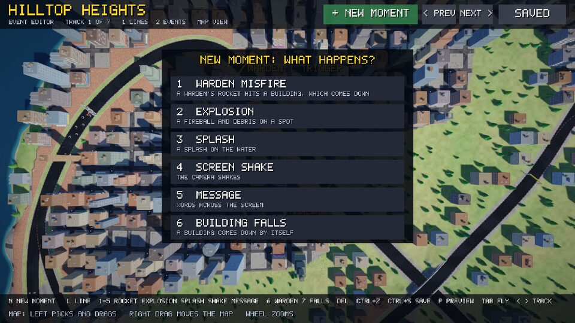

# fcfedit — the event editor

fcfedit scripts what happens during a race on any track: a Warden's rocket misfires and brings a tower down, a message
flashes up, the camera shakes, an explosion goes off as you pass. You make each **moment** with a few clicks, preview it
in a real race, and save it. The game plays it from then on.

(The *track* editor, for roads, hills and tunnels, is a different tool: see [EDITOR.md](EDITOR.md). The event file format
and the race director behind it are in [EVENTS.md](EVENTS.md).)

## Starting it

    make fcfedit && ./fcfedit --track 0      # Linux (x64 and arm64 builds are on the releases page)
    fcfedit.exe --track 0                    # Windows (make windows)
    ./fogcityfury --evedit --track 0         # the same editor inside the game

It opens Hilltop Heights (track 0) unless you name another one. Use **< PREV / NEXT >** at the top, or the `<` `>` keys,
to change track. Your changes are saved first.

## A Warden misfire, start to finish

1. **Place a Warden.** Press `6` and click beside the road. This is where the Warden starts walking (up to four
   Wardens per track).
2. **Click the Warden**, then click **+ MISFIRE** in the panel on the right.
   The editor does the rest:
   - It draws the Warden's own trigger line across the road, about 70 m before the Warden.
   - It aims a rocket a little way past the Warden.
   - It adds a "WARDEN MISFIRE!" message straight after the rocket.
3. **Drag the red ring onto a building.** The building is outlined in red and **COLLAPSE** changes to **YES, IT FALLS**.
   The rocket hitting the building brings it down, so you don't place a separate collapse. Leave the ring on open
   ground and the rocket just explodes there.
4. **Press `P`** to preview the race. Cross the line on lap 1 and watch the tower fall. `F4` comes back to the editor.
5. **`CTRL+S`** (or the **SAVE** button) saves it.

When an event is selected, the **chain box** (top left) shows the whole moment in plain words:

    WHEN YOU CROSS WARDEN 1 TRIGGER  (LAP 1, ONCE)
      WARDEN 1 FIRES AT BUILDING 528, IT FALLS
      THEN MESSAGE "WARDEN MISFIRE!"  (0.4 S LATER)

Click a line in the chain box to select that step. Each step's settings are in the panel on the right (see the
settings table below). To move the trigger, drag either end of its yellow line.

## Any other moment

Press `N` (or **+ NEW MOMENT**), choose what happens, then click what the orange bar asks for:

| Moment | You click |
| --- | --- |
| **Warden misfire** | where cars set it off (two sides of the road) → the Warden who fires → the building it hits |
| **Explosion** | where cars set it off → where it goes off |
| **Splash** | where cars set it off → the water |
| **Screen shake** | where cars set it off |
| **Message** | where cars set it off, then type the words and press `Enter` |
| **Building falls** | where cars set it off → the building (it comes down by itself, no rocket) |

For "where cars set it off" you can also:
- click a line you already have, to reuse it
- press `T`, for the start of a lap instead of a line

`ESC` drops a moment you're halfway through.

**Chaining.** Select any step and click **+ THEN…** under its settings. Whatever you make next happens after that step
(half a second later; change it with DELAY). For example: misfire → screen shake → "LOOK OUT!".

## The settings panel

Click a setting to step it forward, right-click to step it back, and hold `SHIFT` for finer steps.

| Setting | What it does |
| --- | --- |
| KIND | rocket, explosion, splash, screen shake, message, building falls |
| SET OFF BY | crossing a line, a lap starting, a race time, or after another event |
| LAPS | ALL, or any mix of laps 1–6 |
| DELAY | seconds between the trigger and it happening |
| HOW OFTEN | once a race, once a lap, every time |
| CHANCE | 0–100%. The dice come from the track, so every player in a race sees the same thing |
| WHOSE CAR | the player, any car, the leader, a computer car |
| TARGET / FIRED FROM / COLLAPSE | rockets only: what it hits, which Warden fires it, whether that building comes down |
| TEXT | messages only: click it and type |

## Keys

| Key / mouse | Does |
| --- | --- |
| Left click / drag | select, and move a line end, an event, a rocket's red ring or a Warden |
| Right drag, wheel | move and zoom the map |
| `N` | new moment |
| `6` | place a Warden (then click it for **+ MISFIRE**) |
| `L` | draw a line by hand (click its two ends) |
| `1`–`5`, `7` | place a single event by hand: rocket, explosion, splash, shake, message, building falls |
| `DEL` | remove the selection (removing a step also removes the steps chained after it) |
| `CTRL+Z` / `CTRL+S` | undo / save |
| `P`, then `F4` | preview a race with the events as they are now, then come back |
| `TAB` | fly view: `W A S D` move, `Q E` down and up, right drag looks round, `SHIFT` fast |
| `<` `>` (or `[` `]`, `PGUP` `PGDN`) | previous / next track |
| `ALT` while dragging a red ring | don't snap it to a building |

## Where it's saved

- **Built-in tracks:** `events/trackN.fcfe` next to the game. If you're working on the game itself, run
  `python3 tools/embed_events.py` afterwards. It builds the files into the game, which is how the Xbox 360 and
  Android get them.
- **Custom tracks:** beside the track's `.fcft` file.

The files are plain text, so you can read, diff or edit them by hand ([EVENTS.md](EVENTS.md) has the format).

## Limits for now

- Events play in offline races. In 2.3 the server sends its track's event file to everyone in an online race.
- At most four buildings come down in one race.
- Coming in 2.3:
  - dolphins
  - mini Wardens jetpacking off rooftops
  - weather that changes mid-race
  - paths and a timeline in the editor
